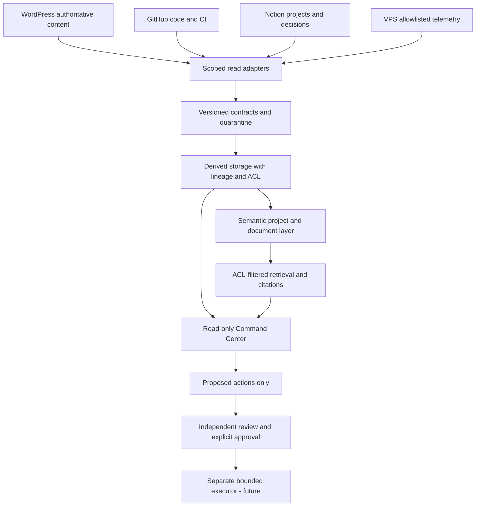

# Jarlhalla Data & AI Architecture 2027

Status: proposed architecture with bounded verified inventory, 2026-10-28. This document does not certify production readiness. No merge, deployment, publication, DNS change, credential rotation or production write is authorized.

## Evidence and coverage

| ID | Source | Observation | Confidence / limitation |
| --- | --- | --- | --- |
| E01 | Referenced chat 6ae173e4-3cc0-83eb-aa5c-233863df14c6, read through chat tool | Seven-layer plan and federated source ownership recovered | Historical planning, not operational proof; original image not interpreted |
| E02 | GitHub accessible repository listing | 87 repository entries returned; see inventory.json for actual count and names | One bounded page of capacity 100; repository access does not prove runtime or all organization assets |
| E03 | GitHub main trees/branches for four app repos | Current immutable revisions recorded below; all protected=true | Detailed protection reads returned 403; independent approvals/admin enforcement unknown |
| E04 | GitHub Actions run collections | Latest main CI succeeds in GI, game and ARC; ArchEng static-site workflow succeeds | Exact run IDs/SHAs in inventory.json; these are remote results, not local reruns |
| E05 | [Existing integration plan](https://app.notion.com/p/406fe29092ad81f79938cc2e8a3e9dd1) | Additive integration, separate business ownership and security history | Planning record; historical test claims not rerun |
| E06 | [Integration registry](https://app.notion.com/p/3f0fe29092ad815bbe1edef5a1927cef) | Gateway, Windows worker, Ollama and scoped task-sync design documented | Old Automatic/complete labels explicitly qualified by later entries |
| E07 | [Command Center](https://app.notion.com/p/3ddfe29092ad81e48eacc72476ad4997) and gateway task 3ddfe29092ad81caa54ff5e3db303582 | Historical v5 sync and v6 chat evidence; gateway v1.1.0 reported | No new authenticated live gateway verification |
| E08 | [Public homepage](https://jarlhalla.com/) via web reader | Existing ecosystem navigation, WordPress footer, consent UI and legacy footer sections visible | Parsed page only; no browser network/cookie/mobile acceptance test |
| E09 | Local knokspack checkout ce004de36be0159c765c3e5b9e53d3ebf86fc84c | README, SECURITY, conduct, CI, deployment guide, console and task-sync code read | Code presence is not deployment evidence |
| E10 | User-supplied VPS login output | Ubuntu 24.04.5, host 45.132.114.61, 04:35:55 UTC, root login shown | Supplied evidence, not independent measurement; update list older than one week |
| E11 | Current tool access tests | No dedicated WordPress/VPS connector; public REST/health reads unavailable; PuTTY batch authentication fails | No supported key in this execution context; no host-key bypass or key search performed |

The accessible listing count is mechanically recorded in inventory.json and can change. Never infer all 87 repositories are production Jarlhalla components. Only the six below received tree-level review.

## Technical architecture register — As-Is and To-Be

| ID / component | As-Is verified or documented | To-Be and authority | Owner / access / dependency |
| --- | --- | --- | --- |
| SYS-WP | Public WordPress surface visible; admin/plugins/database not inventoried | Keep authoritative published content and URLs; read-only API projection | Site owner TBD; published content reader; separate draft writer |
| SYS-NOTION | Existing plan, registry, tasks, content, knowledge and projects located | Operational source of truth, stable IDs, revisions and explicit conflict handling | Workspace owner TBD; selected pages/data sources only |
| SYS-GH | Six repository trees inspected, four app main/CI states observed | Immutable evidence and PR-only code; independent approver; no auto-merge | Maintainer TBD; contents/actions/checks reader; separate PR writer |
| SYS-GATEWAY | Notion reports FastAPI 127.0.0.1:8080 behind automation domain, x-jarlhalla-key | Observe via fixed allowlisted read adapters; separate write executor | Ops owner TBD; runtime/auth/log/config unknown |
| SYS-AI | Repository backend 8787; console uses native Ollama via reverse tunnel 11436 | Preserve local inference; approved data classes and timeout/failure reporting | AI owner TBD; PC, tunnel, model availability dependency |
| SYS-CONSOLE | Knokspack includes private React UI and Python workspace code | Read projection with source freshness, unknown states and no action buttons | Product owner TBD; authenticated operator reader |
| SYS-VPS | User login banner and historical /opt/jarlhalla documented | Scoped telemetry, runtime/deploy map, backup restore proof | Server owner TBD; root session not reused by unattended agents |
| SYS-DATA | Task-upsert Python code present; no common data plane verified | Incremental read ingestion, contract validation, quarantine, lineage | Data steward TBD; derived storage only |
| SYS-SEMANTIC | No shared ontology implementation verified in inspected scope | Project/Asset/Document/Observation/Decision vocabulary, stable source keys | Domain owners TBD; namespaced records, versioned definitions |
| SYS-RAG | No production RAG deployment verified in inspected scope | ACL-first retrieval, provenance, revocation/deletion and evaluation gates | Knowledge owner TBD; approved chunks only |
| SYS-AUDIT | Registry describes JSONL audit; server log not read | Distinct actors, correlation IDs, restricted append storage and retention | Security owner TBD; local audit prototype is not tamper-proof |
| SYS-WORKFLOWS | n8n/HARPA/cPanel/Speckle/Revit/Unreal/Stalwart appear in registry | Inventory actual endpoints, scopes and read/write effects before use | Per-integration owners TBD; disabled/unverified until proven |

### Immutable source baselines

- archeng-nexus: db03824928f179e6c8c4a38ae732cb73afb3dfb3.
- JHLGI: 3d625b4a1755d21204c80b0aab355f96225e7b21.
- JHLgame: 51ee232265dadbf72ccb6ce0aa9a2bd4baf6f148.
- JarlhallaARC: a53eecd58fa85c1d70a490cf495e8fcaec3fc5db.
- knokspack: ce004de36be0159c765c3e5b9e53d3ebf86fc84c.
- JarlhallaCCW: eb56ecec69e79cc039240a088b2afbcd1f897103.

Earlier red-main claims are superseded for the observed revisions: GI #4, game #3 and ARC #3 are merged by prior activity. This session did not merge them. Existing documentation PRs GI #5 and ARC #4 remain open at inventory time. Do not duplicate these changes.

## Verified gap analysis

| Gap | As-Is evidence | Target / acceptance | Priority / risk |
| --- | --- | --- | --- |
| Release authorization | Protected flag and checks visible; full rules 403; shared actor history | Independent review, exact SHA checks, explicit per-environment approval, no bypass | P0; unintended production change |
| Merge attribution | Commit username visible, security log and audit.jsonl not available | Correlate event IDs/timestamps with GitHub security log and gateway logs | P0; actor remains unknown |
| Deployment map | ArchEng static-site run succeeds; Cloud Build queued job only historical | Identify every trigger, service account, artifact and production target | P0; branch push/PR side effects |
| Secrets | ARC corrective merge verified; active-key dependencies unknown | Verify bundle/runtime paths; prepare rotation dependency map; approve actual rotation separately | P0; no secret values collected |
| WordPress privacy | Historical pre-consent tracking failure; current consent UI and Pinterest link visible | Fresh Norway/EEA browser test for reject/accept/revoke, scripts/cookies; approved remediation | P0; current behavior unverified |
| Access isolation | Existing gateway key described; code-level auth differs by service | Scoped reader identities, tenant/project ACL, revoke tests and independent approval identity | P0; cross-project disclosure |
| Operational truth | README version 2 vs package 3; SECURITY support matrix 5.x/4.x and placeholder contact | Maintainer confirms support policy and contact; update separately | P1; inaccurate operations guidance |
| Data consistency | Notion upsert has stable sync ID, revision check and lock | Read contracts, source revision, watermark, dedup, retries and deletion propagation | P1; avoid duplicate authoritative records |
| Semantic/RAG | Plan only in inspected scope | ACL-aware derived index with lineage and evidence-grounded eval | P2 after P0/P1; leakage/hallucination |
| Resilience | Tunnel and backups historically reported | Actual reconnect and isolated restore test evidence | P1; loss of availability or recoverability |

## Target architecture and decisions

- ADR-001 proposed: retain source systems; no replacement, database migration or automatic writeback.
- ADR-002 proposed: begin with offline local projections and synthetic tests; connect readers only after identity and deployment effects are verified.
- ADR-003 proposed: select PostgreSQL/object storage/vector index only after actual inventory, capacity, backup and operating ownership are known. Do not provision infrastructure from the diagram.
- ADR-004 proposed: approval must bind action, artifact digest/SHA, environment, approver, expiry and evidence. Chat approval cannot be inferred from green CI. Revalidate after new commits.
- ADR-005 proposed: apply ACL before retrieval, include ACL in cache scope, recheck before prompt construction; deletion and revocation invalidate chunks/caches. Retrieved text cannot call tools.
- ADR-006 proposed: foundation module is advisory and disconnected from live services; no API route or deployment hook is added.

## Data and semantic contracts

See CONTRACTS.md for normative fields, evolution and data ownership. Initial canonical entities:

| Entity | Stable key | Authority | Relations |
| --- | --- | --- | --- |
| Project | namespace + source ID | Existing Notion Projects | business unit, assets, decisions |
| CodeRevision | repository + commit SHA | GitHub | project, workflow run, artifact |
| ContentDocument | WordPress site + post ID or Notion page ID | Owning source | project, revision, source URL |
| Observation | source + observation ID + observed time | Source evidence | target revision, gate check |
| Decision | Notion decision ID | Authorized human record | action, revision, environment, evidence |
| KnowledgeChunk | document ID + revision + chunk ID | Derived only | lineage, ACL, expiry/deletion |

No customer/BIM/private content is copied during this inventory. Build federated identity mapping explicitly; equal emails or similar titles are not sufficient identity links.

## Approval ports and rollout

1. G0 inventory: accepted evidence coverage, reader identities, deploy map, unresolved risks. No production mutation.
2. G1 PR: reviewed diff, exact revision tests, negative security cases, dependency checks and rollback plan. PR creation does not authorize merge.
3. G2 isolated staging: explicit environment approval, verified backup/restore, authenticated smoke/regression tests, no production credentials.
4. G3 production: explicit action/revision/environment approval, independent review and all applicable fresh gates PASS. UNKNOWN/BLOCKED fails closed.
5. G4 post-release: actual route/content/auth/consent checks and observed rollback readiness; no automatic remediation.

Rollback for these additive foundation files: close unmerged PR or revert its commit on a new branch. No data migration, runtime integration or infrastructure side effect is introduced.

## Outstanding evidence requests

- Existing SSH/PuTTY session or scoped reader; this process cannot authenticate with Pageant. Collect service names/versions/listeners, Nginx server names, container mounts without environment values, backup catalog and restore-test IDs. Do not dump .env, keys, wp-config.php, customer data or full logs.
- WordPress plugin/theme versions, canonical URLs and safe route inventory; current consent network test from Norway/EEA; draft 18289 and unresolved CONFIRM list via authorized reader.
- GitHub detailed protections/rulesets, security-log excerpt for merge window, and gateway audit excerpt with tokens/personal data redacted.
- Cloud Build job ID, trigger, service account, target and status; no cancellation/rerun allowed.
- Explicit data ownership, retention, inference policy, budget, SLO/RPO/RTO, design guide and independent reviewers.

## Execution status

Documentation and offline foundation are review candidates. Live adapters, authenticated Command Center integration, production audit storage, semantic datastore and RAG service remain backlog work. No claim of completed 2027 platform is made.
